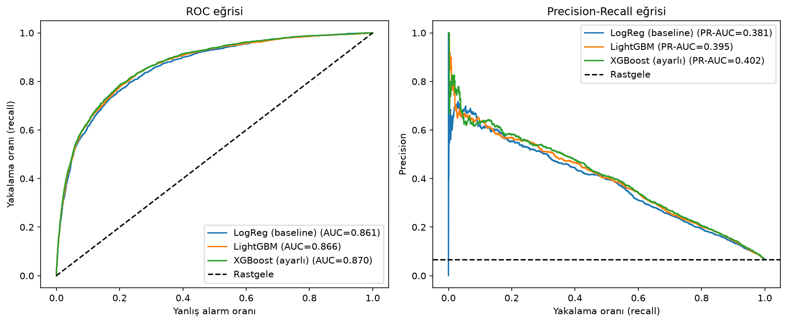
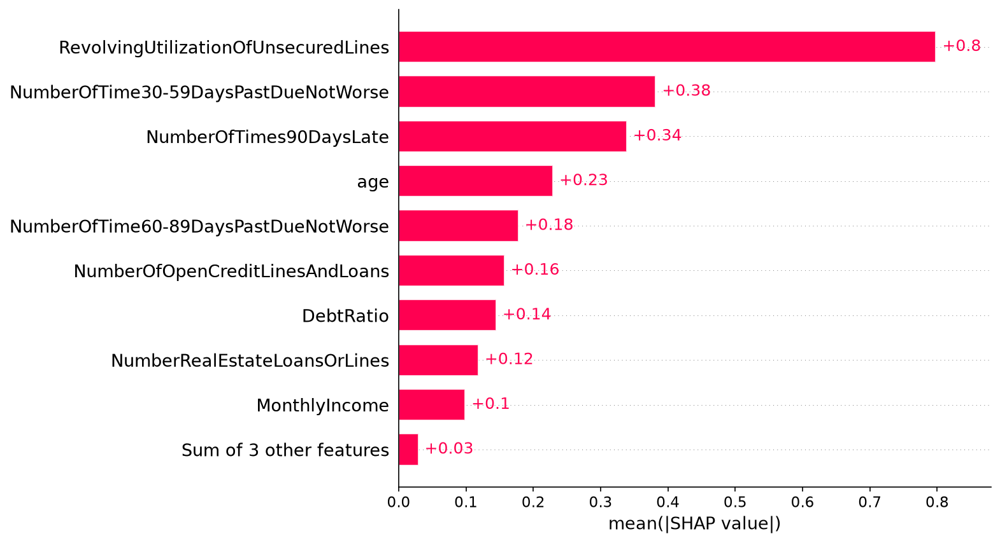
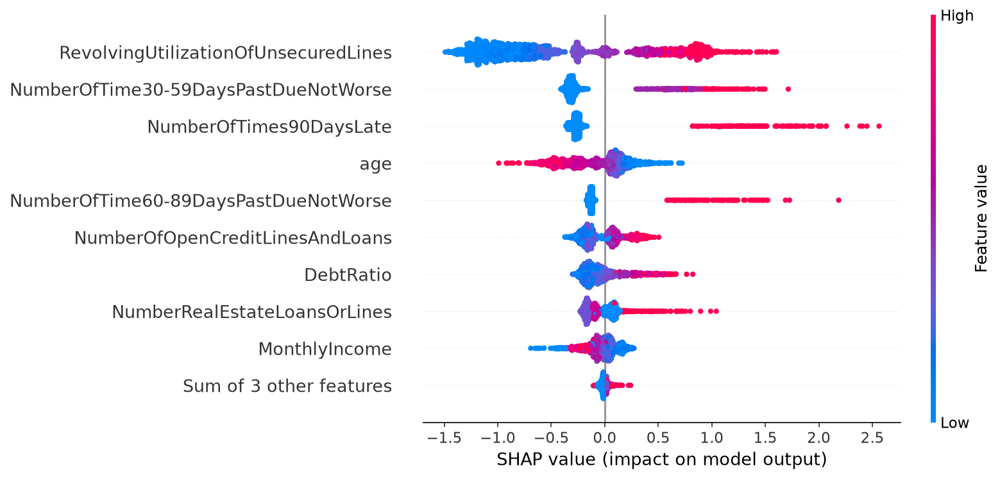
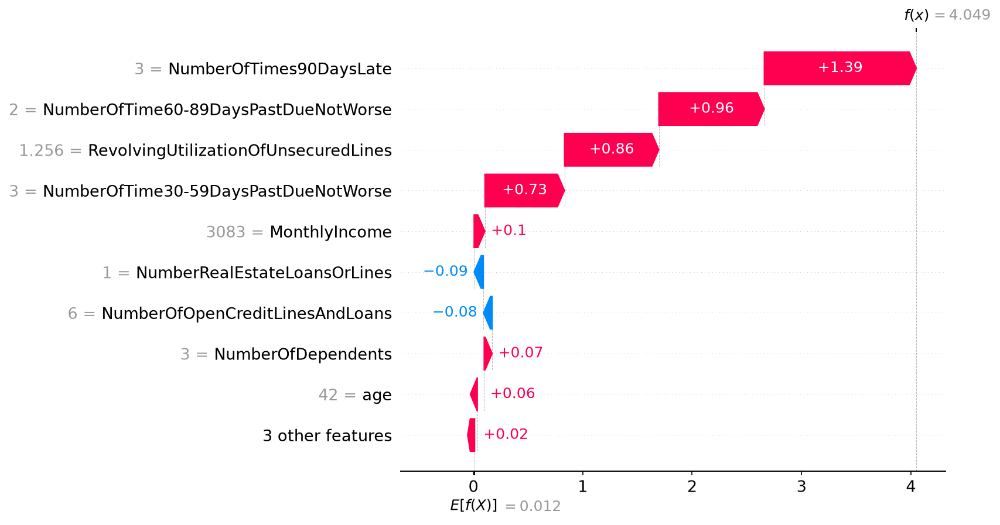

# Kredi Riski Tahmini: Temerrüt Öngörüsü

Bir müşterinin önümüzdeki 2 yıl içinde 90 gün veya daha fazla gecikmeli ödeme (temerrüt) yapıp yapmayacağını tahmin eden, sınıf dengesizliği, iş maliyeti ve açıklanabilirlik odaklı bir makine öğrenmesi projesi.

**Yazar:** Şamil Tokat ([GitHub](https://github.com/Samiltokat97))

## Problem

Banka, kredi başvurusu yapan bir müşterinin geri ödeme riskini önceden bilmek ister. Hedef değişken `SeriousDlqin2yrs` (1 = temerrüt, 0 = değil).

Bu problem iki nedenle göründüğünden zordur. Birincisi, müşterilerin yalnızca %6,7'si temerrüde düşüyor; yani veri güçlü biçimde dengesiz ve modelin asıl öğrenmesi gereken azınlık sınıfı çok küçük. İkincisi, iki hata türü bankaya aynı maliyeti yüklemiyor: riskli bir müşteriye kredi verip parayı kaybetmek, iyi bir müşteriyi yanlışlıkla reddetmekten çok daha pahalı. Bu yüzden iyi bir model yalnızca doğru tahmin yapmakla kalmaz, hata dengesini de iş maliyetine göre ayarlayabilmelidir.

## Veri

- Kaynak: Kaggle, [Give Me Some Credit](https://www.kaggle.com/competitions/GiveMeSomeCredit) yarışması (`cs-training.csv`)
- 150.000 müşteri, 10 özellik, temerrüt oranı %6,7
- Yarışma kuralları gereği ham veri bu depoda **paylaşılmıyor**; Kaggle'dan indirip `data/` klasörüne koyun.

## Yöntem

**Veri temizliği (kararlar veriye bakılarak verildi):**

- `age = 0` olan 1 hatalı satır silindi.
- Üç gecikme sütununda görülen 96 ve 98 değerleri gerçek sayı değil özel kod. Bu satırlarda (269 adet) temerrüt oranı %54,6 iken diğerlerinde %6,6. Satırlar silinmedi: bilgi `gecikme_ozel_kod` bayrağına alındı, değerler eksik veriye çevrildi.
- `MonthlyIncome` %19,8 eksik. `gelir_eksik` bayrağı eklendi, doldurma pipeline içinde (medyan) yapıldı.
- Gelir eksik satırlarda `DebtRatio` oran yerine tutar gibi davranıyor (medyan 1159, gelir dolu satırlarda 0,296). Bu satırlarda değer eksik kabul edildi.
- `RevolvingUtilizationOfUnsecuredLines` en fazla 2'ye sınırlandı.

**Değerlendirme kurgusu:** %80 eğitim / %20 test, sınıf oranı korunarak (stratify). Model seçimi ve parametre ayarı yalnızca eğitim verisinde 3-5 katlı çapraz doğrulamayla yapıldı; test verisi sadece sonda kullanıldı. Doldurma ve ölçekleme pipeline içinde olduğundan test verisinden sızıntı yok.

**Metrik seçimi:** Accuracy bu problemde yanıltıcıdır. Herkese "temerrüde düşmez" diyen bir model %93,3 accuracy alır ama tek bir riskli müşteriyi bile yakalamaz. Bu yüzden modelin müşterileri risk sırasına dizme kalitesini ROC-AUC ile, azınlık sınıfındaki başarısını PR-AUC ve recall ile ölçtüm.

## Sonuçlar

| Model | ROC-AUC | PR-AUC |
|---|---|---|
| Logistic Regression (baseline) | 0,861 | 0,381 |
| LightGBM | 0,866 | 0,395 |
| XGBoost (ayarlı) | 0,870 | 0,402 |

Rastgele bir modelin PR-AUC değeri temerrüt oranına eşit, yani yaklaşık 0,067. Her model en riskli %10 müşteriyi işaretlediğinde gerçek temerrütlerin yaklaşık %55'ini yakalıyor.



**Bulgu:** Modeller arasındaki fark küçük (çapraz doğrulama standart sapması ≈ 0,006). Parametre ayarı da test skorunu neredeyse hiç değiştirmedi (0,869 → 0,870). Bu veride performansı model karmaşıklığından çok verinin içerdiği bilgi sınırlıyor. Bu nedenle üretimde, yorumlaması kolay Logistic Regression savunulabilir bir tercih olurdu.

## İş maliyetine göre eşik seçimi

Gerçek maliyetler bilinmediği için, bir temerrüdü kaçırmanın yanlış alarmdan 3, 5 ve 10 kat pahalı olduğu üç senaryo denendi. Eşik yalnızca eğitim verisindeki çapraz tahminlerle seçildi, sonra test verisinde bir kez uygulandı.

| Kaçırma / yanlış alarm maliyet oranı | Seçilen eşik | Precision | Recall | Herkese kredi vermeye göre kayıp azalması |
|---|---|---|---|---|
| 3 | 0,80 | 0,424 | 0,473 | %25,9 |
| 5 | 0,70 | 0,350 | 0,589 | %37,0 |
| 10 | 0,60 | 0,278 | 0,688 | %51,0 |

Kaçırılan temerrüt pahalılaştıkça eşik düşüyor: banka daha fazla yanlış alarmı göze alıp daha çok riskli müşteri yakalıyor. Modelde sınıf ağırlığı kullanıldığı için skorlar olasılık olarak değil, sıralama için yorumlanmalı.

**Precision ve recall arasındaki takas:** Eşiği düşürdükçe daha fazla müşteriye "riskli" diyoruz. Böylece gerçek temerrütlerin daha büyük kısmını yakalıyoruz (recall artıyor), ama işaretlediklerimizin içinde iyi müşteriler de çoğalıyor (precision düşüyor). Örneğin baseline modelde 0,5 eşiğinde gerçek temerrütlerin yaklaşık %75'i yakalanıyor, ama "riskli" denen her 100 müşterinin yalnızca 22'si gerçekten temerrüde düşüyor. Doğru nokta matematikle değil maliyetle belirlenir: kaçırılan kredi ne kadar pahalıysa, bankanın o kadar çok yanlış alarmı kabul etmesi mantıklıdır.

## Açıklanabilirlik (SHAP)

Modelin kararında en etkili özellikler: kredi limiti kullanım oranı, geçmiş gecikme sayıları (30-59, 60-89 ve 90+ gün) ve yaş. Limitin büyük kısmını kullanan ve gecikme geçmişi olan müşteriler daha riskli skorlanıyor; yaş arttıkça skor düşüyor.





## Sınırlılıklar

- Maliyet oranları varsayımdır; gerçek değerler kredi tutarına ve faiz gelirine bağlıdır.
- SHAP nedensellik değil, modelin neye baktığını gösterir.
- Yaş gibi özellikler gerçek kredi kararlarında yasal olarak kısıtlı olabilir; adillik analizi yapılmadı. Bu bir portfolyo projesidir, gerçek kredi kararları için kullanılmamalıdır.
- Veri tek bir yarışmadan ve tek bir dönemdendir; zamana göre bölme yapılmadı.

## Çalıştırma

```bash
# Depoyu klonla
git clone git@github.com:Samiltokat97/credit-risk-project.git
cd credit-risk-project

# Sanal ortamı kur ve kütüphaneleri yükle
python -m venv .venv
source .venv/bin/activate
pip install -r requirements.txt

# cs-training.csv dosyasını Kaggle'dan indirip data/ klasörüne koy,
# sonra notebooks/01_eda.ipynb dosyasını çalıştır
```
